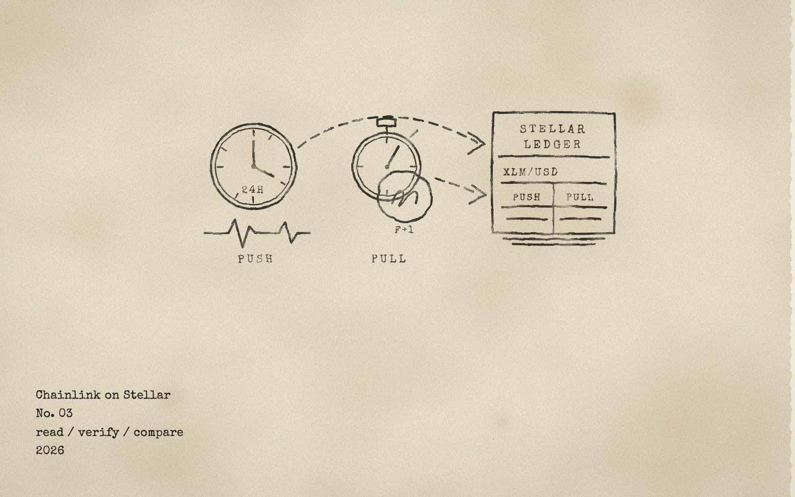

# Field Note No. 03: Chainlink on Stellar

*read / verify / compare. 2026.*



## Attribution

- **Built by:** Kaan Kacar, Developer Relations at the Stellar Development Foundation. GitHub [kaankacar](https://github.com/kaankacar). Live demo: [kaankacar.github.io/stellar-chainlink-demo](https://kaankacar.github.io/stellar-chainlink-demo/).
- **Release:** Chainlink Data Feeds and Data Streams on Stellar mainnet, announced 14 October 2026. [The launch post on the Stellar blog](https://stellar.org/blog/foundation-news/chainlink-is-now-live-on-stellar-unleashing-a-new-wave-of-defi-innovation), [Two Ways to Read Chainlink Prices on Stellar](https://stellar.org/blog/developers/ways-to-read-chainlink-prices-on-stellar-data-feeds-and-data-streams) from 19 October, and the [oracle providers page](https://developers.stellar.org/docs/data/oracles/oracle-providers) in the docs.
- **Demo:** the walkthrough video `DR-5_chainlink-field-note_2026-11-10.mp4` and the screenshots `DR-5_chainlink-field-note_00` to `12` in the Drive folder `Demos + Field Notes/Chainlink`. Code: [github.com/kaankacar/stellar-chainlink-demo](https://github.com/kaankacar/stellar-chainlink-demo), MIT.
- **Repos used:** Chainlink's [chainlink-stellar](https://github.com/smartcontractkit/chainlink-stellar) (the Data Feeds proxy interface, copied by hand because there is no crate) and [data-streams-stellar](https://github.com/smartcontractkit/data-streams-stellar) (the verifier, read for its interface and error codes). Docs: the [Stellar Data Feeds guide](https://docs.chain.link/data-feeds/stellar) and the [Data Streams Stellar tutorial](https://docs.chain.link/data-streams/tutorials/stellar-onchain-report-verification), whose sample report is the only signed report in this note. Versions: `soroban-sdk` 29.0.1, Stellar CLI 26.0.0, `@stellar/stellar-sdk` 17.2.1. I forked nothing and deployed no copy of Chainlink's contracts: my contract calls the proxy and the verifier Chainlink deployed. Not affiliated with Chainlink Labs.

## 1. What I built

The brief was one sentence: read a Chainlink Data Feed from a Soroban contract on testnet.

Chainlink shipped two things on Stellar, and the second one changes what the first one means, so I built for both. **Two Clocks** is a small Soroban contract that keeps two prices per asset. The **push** price comes from the Data Feeds proxy: one contract per network serves every feed, you pass a 32-byte id, you get a round with a price at 18 decimals and a timestamp. The **pull** price comes from a Data Streams report: a signed blob you fetch off-chain, hand to Chainlink's verifier contract, and decode after it has checked the signatures. The contract stores both legs with their timestamps, refuses what is stale, computes the spread between them, and answers the one question a lending or perps protocol asks: give me the freshest price you trust, or tell me there is none. Around it: a script that refreshes all ten feeds in one transaction, a watcher that does that in a loop, a script that pushes a report through the verifier, and a read-only page with both columns.

I ran it on testnet only. The proxy and the verifier are deployed on testnet and mainnet with the same interface, and reading either by simulation costs nothing, so the recon run reads mainnet too, without a key and without a transaction.

**Read this before you budget a build on it.** The push side is free to read: ten USD feeds, no key, no subscription, one simulation per read. The pull side is a paid product. Chainlink closed the free tier on 1 September 2026 and sells streams from $150 per month per feed. The Chainlink Platform gave me a username and a secret. On the testnet API they answer `401 user does not exist`. On the mainnet API they authenticate, list zero feeds, and answer `401 feeds not authorized` for every stream (the day before it was `404 report not found`). Nothing in either body says "subscribe". The only signed report a developer can get for free is the sample in Chainlink's tutorial, signed on 3 April 2026 and expired on 3 May. So this note reads live push prices on both networks and runs the pull path with a report that expired six months ago. The verifier accepts it. My contract rejects it as expired. That is the demo, and it shows what a free account can and cannot do.

**Push or pull.** A Data Feed is a promise: the price on chain moves when the market moves 0.5 percent, or after 24 hours, whichever comes first. Chainlink's network writes it, you pay nothing to read it, and on a quiet day the stored price can be hours old and still be the right one. A Data Streams report is a signature with an expiry: you fetch it when you need it, you pay the subscription and the transaction that verifies it, and you get a price that is seconds old with bid and ask. On both legs the freshness check is yours. The proxy does not do it, and the verifier does not either.

Other friction: there is no crate or npm package for the Stellar interfaces, you copy a trait. Chainlink's tutorial pins `soroban-sdk` 25 and warns about Rust 1.91; 29 and 1.95 worked. The docs list a `FeedFrozen` error in the wrong table, and it reaches you as a bare `#109`. The Candlestick API, which my free account can use, serves 18-decimal prices as JSON floats and loses the low digits of ETH and BTC on the way out.

Time: one day on 10 November, after a day of reading and probing on 9 November.

## 2. How it went

Five runs on 10 November and one after the site went public. Every transaction went to testnet; run 0 also read mainnet by simulation, which costs nothing. The logs with timestamps and transaction links are in `docs/field-note/runs/`. Only the numbers that carry a finding are here.

**Run 0, recon.** `pnpm recon`. Both proxies answer `DataFeedsProxy 1.0.0` and serve the same ten ids. XLM/USD on testnet: 0.143892, round 2365, 7 minutes old; on mainnet 0.144367, round 2451, 33 minutes old. USDT, USDC and the two RWA feeds sat 17 to 24 hours behind their last move, inside the heartbeat, exactly as a 0.5 percent trigger predicts on a flat day. An unknown id gives `#50`, `decimals: 0` gives `#51`, and asking for 8 decimals truncates. Then the pull side: Chainlink's sample report verified on the testnet verifier by simulation and came back byte for byte as my local decode. One flipped bit in the price gave `#12 BadVerification`. The same bytes on the mainnet verifier gave `#9 DigestNotSet`: a report is signed for one network. Then the API with my credentials: testnet `401 user does not exist`, mainnet `{"feeds":[]}` and `401 feeds not authorized`. The Candlestick API let the same account in and returned seven hourly ETH candles. Nothing was signed. (Screens 01 to 03.)

**Run 1, deploy.** `pnpm run deploy -- --network testnet`. A 23 KB wasm. Upload 1.54 XLM, create 18.70 XLM. The constructor extends every entry to 90 days and renews only inside the last 30, instead of the 180-day maximum on every call, which cost 211 XLM in No. 02. Contract `CDJTBGMNA4T2Q4IALTUQVNSUTFHISVQIDKMKNKW26AYJIM5QWFQ3I4FP`, ten assets, six of them with a testnet stream id. (Screen 04.)

**Run 2, one refresh.** `pnpm refresh -- --network testnet`. One transaction, ten proxy calls, ten push legs stored, 0.71 XLM: the first write of ten persistent entries pays their 90 days at once. FLHY/USD was 23 h 39 min old with 19 minutes left on its heartbeat; the crypto feeds were minutes old. (Screens 05 and 08.)

**Run 3, the expired report.** `pnpm submit -- --network testnet --expect-expired`. The local decode, then `verify_report` through my contract by simulation: the verifier returned the report, the fields matched. Then `submit_report`: `#23 Expired` at the simulate stage, 191 days past `expiresAt`, nothing sent, no fee. The verifier says the signatures are good. The consumer says the price is dead. Both are right. (Screens 06, 09 and 10.)

**Run 4, the watch.** `pnpm watch -- --network testnet --every 600 --minutes 120`. Thirteen rounds, 41 push legs stored, two rounds skipped as `NothingNew` at the simulate stage, which costs nothing. 0.051 XLM for two hours. The 0.5 percent trigger showed its shape: XLM, BTC, ETH and LINK each moved six to nine times, about every 10 to 15 minutes, in an afternoon with a 1.8 percent XLM swing. Gold, with its 0.1 percent trigger, moved eleven times. EURC moved once. FLHY moved once, at the 24-hour heartbeat, 23 h 59 min after its previous round. USDT, USDC and USPC did not move at all. A consumer that needs a stablecoin price younger than an hour cannot get it from a push feed on a flat day; that is what the pull side is for. (Screen 07.)

**Run 5, after the site went public.** The repo and the board went public an hour after the watch ended. One more `pnpm refresh` so the first visitor sees fresh rows: five of the ten feeds had a newer round, one transaction, 0.010 XLM. The other five were already current.

**The page.** It reads `latest_many` by simulation every 10 seconds and shows both columns per asset with the age and the heartbeat countdown. The verify box takes a report, runs it through the contract by simulation, and prints the decoded fields, the expiry, and the error name when there is one. The mainnet toggle reads the ten feeds from the mainnet proxy, by simulation, with no deployment. (Screens 08 to 11.)

## 3. The mental model that made it click

**One proxy, one id per feed.** There is no aggregator address to find. Every feed on Stellar lives behind the same contract and is picked by a 32-byte id that is the same on testnet and mainnet. The id is the thing to pin, not an address.

**A push feed is a 24-hour promise with a 0.5 percent trigger.** The price on chain moves when the market moves half a percent, or after 24 hours, whichever comes first. On a quiet day the stored price can be hours old and still be the right one. Freshness is a number you compare with the heartbeat, not a boolean.

**The verifier checks who signed, never when.** `verify` recovers f+1 signatures and returns the bytes. It accepted a report from April in November. The report carries `expiresAt` and `observationsTimestamp`, and the consumer contract is where they get enforced. That is not a gap, it is the division of labour, and it has to be in your code.

**The contract is the sender.** `verify` wants a `sender` that authorizes the call. A contract that calls the verifier directly can pass its own address and needs no user signature for that step. The user authorizes the contract, the contract authorizes the verifier.

**18 decimals, and truncation is yours.** Both products use 18 decimals. Ask the proxy for fewer and it truncates. Store the raw integer and scale in the consumer.

**A free account gets charts, not proofs.** The Candlestick API answered my account with history. The report API answered with 401. Charts are not signed, and a contract cannot verify a candle.

## 4. Friction log

The log is [friction-log.md](https://github.com/kaankacar/stellar-chainlink-demo/blob/main/docs/field-note/friction-log.md): 7 rows, only the problems that change a developer's experience and that Chainlink can act on. Everything else I hit, my own mistakes and tooling included, is in [friction-log-full.md](https://github.com/kaankacar/stellar-chainlink-demo/blob/main/docs/field-note/friction-log-full.md).

What I would ask Chainlink to fix, in order:

1. Give developers a way to rehearse the pull path for free: a testnet tier, or a fresh signed testnet report every month, and a list of the streams the Stellar verifier accepts. Resolve "self-serve, no sales call" against "an allowlisted account in the Access Controller" on the same page (C1).
2. Say on the credentials page which environment a key belongs to, and make the API say "no subscription for this stream" instead of `user does not exist`, `report not found` and `feeds not authorized` (C2).
3. Move `FeedFrozen` out of the `ProxyReadError` table and document code 109 (C3).
4. Publish the Stellar interfaces as a crate, update the tutorial's pins, declare `verify` with its real `Result` type, drop the test step that points at tests the scaffold does not have, and put the `expiresAt` check into the consumer example (C4).
5. Fix the retired `soroban.stellar.org` links, the changelog link and the missing mainnet verifier id in the `.md` and `llms-full.txt` copies (C5). Name the id field in the feed-list JSON `dataId` and fix the FLHY label (C6).
6. Serialize Candlestick values as strings, or at 8 decimals, and document the `XLMUSD` symbol format (C7).

## 5. Where I think this goes

Chainlink on Stellar is two products with two economies, and the note is only honest if it says so. Data Feeds are ready for the protocols the launch names: free to read, ten assets, a proxy you can call from any contract in one line, and a freshness rule you write yourself. That is enough for lending, stablecoin logic and vaults today. Data Streams are the perps and liquidation story, and they are a subscription. A builder cannot rehearse that path end to end on a free account, and the one public report expired in May. Until a testnet tier or a fresh sample exists, the pull side stays a demo of the verifier, not of the product. What I would watch: the feed list growing past ten, which the NAV and reference-rate feeds already hint at, and the first Stellar protocol that pays for a stream and shows the sub-second path in production. For anything that holds funds, two sources and a divergence check still apply. Two Clocks compares Chainlink with Chainlink. The next column is another oracle.

## 6. Try it yourself

```bash
git clone https://github.com/kaankacar/stellar-chainlink-demo && cd stellar-chainlink-demo
pnpm install && pnpm recon                          # read-only on both networks, no key needed
pnpm read-feed -- --network mainnet --asset xlm      # one proxy read by simulation
cp .env.example .env                                # a testnet key, and Data Streams credentials if you have them
pnpm build:wasm && pnpm run deploy -- --network testnet
pnpm refresh -- --network testnet                   # ten feeds in one transaction, then open the site
```

- Repo and live board: [github.com/kaankacar/stellar-chainlink-demo](https://github.com/kaankacar/stellar-chainlink-demo), [kaankacar.github.io/stellar-chainlink-demo](https://kaankacar.github.io/stellar-chainlink-demo/).
- Chainlink's [Data Feeds on Stellar](https://docs.chain.link/data-feeds/stellar), [feed list](https://docs.chain.link/data-feeds/price-feeds/addresses?network=stellar) and [Data Streams on Stellar](https://docs.chain.link/data-streams/tutorials/stellar-onchain-report-verification).
- Stellar's [oracle providers page](https://developers.stellar.org/docs/data/oracles/oracle-providers) and the [Two Ways post](https://stellar.org/blog/developers/ways-to-read-chainlink-prices-on-stellar-data-feeds-and-data-streams).
- Bring questions to the next Stellar Developers Meeting.
